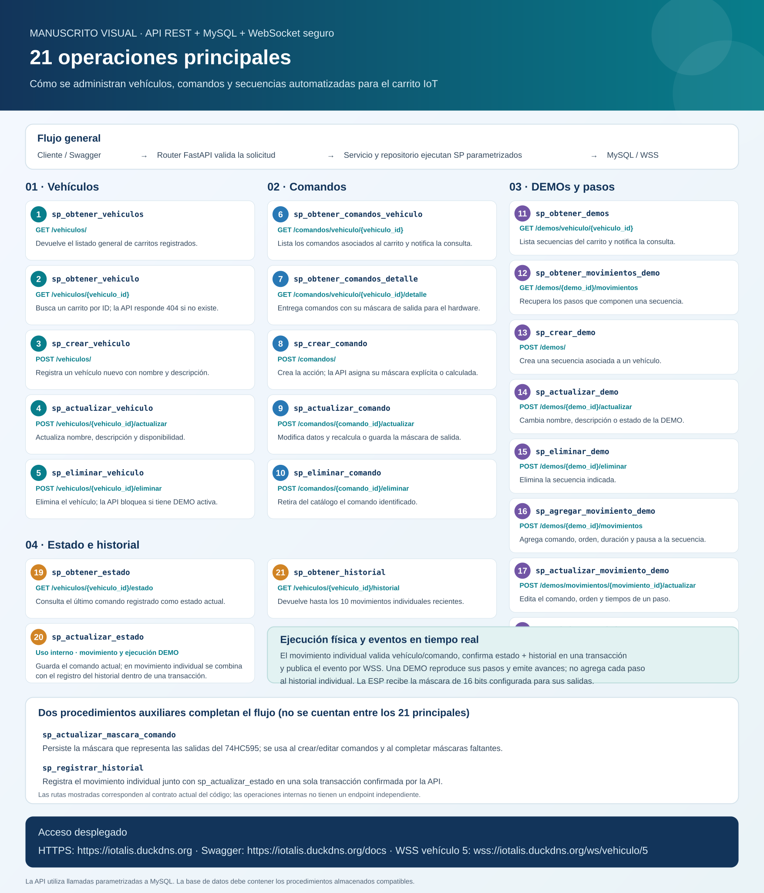

# API de gestion de vehiculos IoT

API REST con FastAPI para administrar vehiculos, comandos, movimientos y secuencias DEMO. La aplicacion usa una arquitectura orientada a objetos, MySQL mediante procedimientos almacenados y WebSockets para enviar eventos en tiempo real a los dispositivos conectados.

## API desplegada

- **URL HTTPS de la API:** [https://iotalis.duckdns.org](https://iotalis.duckdns.org)
- **Swagger UI / documentación interactiva:** [https://iotalis.duckdns.org/docs](https://iotalis.duckdns.org/docs)
- **Dirección WSS del vehículo 5:** [`wss://iotalis.duckdns.org/ws/vehiculo/5`](wss://iotalis.duckdns.org/ws/vehiculo/5)

En Swagger puedes consultar los parámetros y esquemas de cada endpoint y ejecutar solicitudes de prueba. El WebSocket utiliza TLS y queda asociado al vehículo indicado en la ruta.

## Contenido del repositorio

- Codigo Python de la API y sus modulos.
- `requirements.txt` con las dependencias.
- Esta guia con instrucciones, endpoints, procedimientos almacenados y eventos WebSocket.

No se incluyen archivos `.env`, contrasenas, certificados privados, copias de bases de datos ni firmware Arduino. Los procedimientos almacenados deben estar instalados previamente en la base de datos configurada.

## Requisitos

- Python 3.10 o posterior.
- MySQL compatible con los procedimientos almacenados del proyecto.
- Acceso de red desde la API a la base de datos.

## Instalacion y ejecucion local

Desde la carpeta del proyecto, en PowerShell:

```powershell
python -m venv .venv
.\.venv\Scripts\Activate.ps1
python -m pip install -r requirements.txt
```

Configura estas variables en el entorno del proceso que ejecutara la API. Para desarrollo local tambien puedes guardarlas en un `.env` local; Git ignora ese archivo y no debe subirse al repositorio.

| Variable | Descripcion |
|---|---|
| `DB_HOST` | Host de MySQL |
| `DB_PORT` | Puerto MySQL (opcional; predeterminado `3306`) |
| `DB_NAME` | Nombre de la base de datos |
| `DB_USER` | Usuario de la base de datos |
| `DB_PASSWORD` | Contrasena de la base de datos |

Ejemplo para establecer valores solo en la sesion actual de PowerShell (sustituye los marcadores localmente; no guardes valores reales en el codigo ni en Git):

```powershell
$env:DB_HOST = "<host-mysql>"
$env:DB_PORT = "3306"
$env:DB_NAME = "<base-de-datos>"
$env:DB_USER = "<usuario>"
$env:DB_PASSWORD = "<contrasena>"
python -m uvicorn main:app --reload --host 127.0.0.1 --port 8000
```

La documentacion interactiva queda disponible en `http://127.0.0.1:8000/docs`. Para pruebas desde otro dispositivo de la misma LAN, configura el host de Uvicorn y el firewall de acuerdo con tu entorno; no expongas el servidor de desarrollo directamente a Internet.

En produccion, utiliza un servicio de procesos y un proxy HTTPS/WSS configurados para la red correspondiente. El endpoint seguro de WebSocket es `wss://<dominio>/ws/vehiculo/{vehiculo_id}`.

## Arquitectura

```text
main.py
  -> core/             Contenedor de dependencias y reglas compartidas
  -> routers/          Controladores HTTP y WebSocket
  -> schemas/          Validacion de solicitudes con Pydantic
  -> services/         Operaciones, movimientos, DEMOs y eliminaciones
  -> repositories/     Acceso a datos mediante procedimientos MySQL
  -> models/           Entidades de dominio
  -> ws_manager/       Clientes conectados, eventos y difusion
  -> config/           Conexion y configuracion de base de datos
```

Los controladores y repositorios se construyen con dependencias inyectadas por `core/contenedor.py`. `BaseController` registra rutas comunes y `BaseRepository` centraliza consultas, escritura, transacciones y conversion de resultados a entidades.

## Endpoints HTTP

Todas las rutas se documentan en `/docs`. Las operaciones de modificacion y eliminacion usan `POST`, segun el contrato actual de la API.

### General

| Metodo | Ruta | Funcion |
|---|---|---|
| GET | `/` | Informacion basica del servicio, documentacion y ruta WebSocket |

### Vehiculos y operaciones

| Metodo | Ruta | Funcion |
|---|---|---|
| GET | `/vehiculos/` | Listar vehiculos |
| GET | `/vehiculos/{vehiculo_id}` | Obtener un vehiculo |
| GET | `/vehiculos/{vehiculo_id}/estado` | Consultar el estado mas reciente |
| GET | `/vehiculos/{vehiculo_id}/historial` | Consultar los 10 movimientos recientes |
| GET | `/vehiculos/{vehiculo_id}/detalle-completo` | Obtener vehiculo, comandos, estado y DEMOs |
| POST | `/vehiculos/` | Crear vehiculo |
| POST | `/vehiculos/{vehiculo_id}/actualizar` | Actualizar vehiculo |
| POST | `/vehiculos/{vehiculo_id}/eliminar` | Eliminar vehiculo (409 si tiene una DEMO activa) |
| POST | `/vehiculos/{vehiculo_id}/movimiento` | Ejecutar un movimiento individual |
| POST | `/vehiculos/{vehiculo_id}/mensaje` | Enviar texto al dispositivo conectado |
| POST | `/vehiculos/{vehiculo_id}/demo/iniciar` | Iniciar una DEMO |
| POST | `/vehiculos/{vehiculo_id}/demo/detener` | Cancelar la DEMO activa |

Ejemplo de cuerpo para ejecutar un comando:

```json
{
  "comando_id": 1,
  "origen": "WEB_API"
}
```

### Comandos

| Metodo | Ruta | Funcion |
|---|---|---|
| GET | `/comandos/vehiculo/{vehiculo_id}` | Listar comandos de un vehiculo |
| GET | `/comandos/vehiculo/{vehiculo_id}/detalle` | Listar comandos y sus mascaras de salida |
| POST | `/comandos/` | Crear comando |
| POST | `/comandos/{comando_id}/actualizar` | Actualizar comando |
| POST | `/comandos/{comando_id}/eliminar` | Eliminar comando |
| POST | `/comandos/{comando_id}/mascara` | Asignar mascara de salida |

Las mascaras deben corresponder al cableado de los registros 74HC595. Se pueden enviar explicitamente; el backend tambien tiene un mapa automatico por nombre y usa mascara `0` para nombres que no reconoce.

### DEMOs

| Metodo | Ruta | Funcion |
|---|---|---|
| GET | `/demos/vehiculo/{vehiculo_id}` | Listar DEMOs de un vehiculo |
| GET | `/demos/{demo_id}/movimientos` | Listar los pasos de una DEMO |
| POST | `/demos/` | Crear DEMO |
| POST | `/demos/{demo_id}/actualizar` | Actualizar DEMO |
| POST | `/demos/{demo_id}/eliminar` | Eliminar DEMO |
| POST | `/demos/{demo_id}/movimientos` | Agregar paso a una DEMO |
| POST | `/demos/movimientos/{movimiento_id}/actualizar` | Actualizar paso |
| POST | `/demos/movimientos/{movimiento_id}/eliminar` | Eliminar paso |

## Procedimientos almacenados

El siguiente manuscrito visual resume las **21 operaciones principales** implementadas con procedimientos almacenados, las rutas HTTP que las utilizan y el flujo desde la solicitud hasta MySQL y el dispositivo. No representa 21 rutas HTTP: algunas rutas coordinan varias operaciones y `sp_actualizar_estado` se ejecuta internamente. Además, el código utiliza dos procedimientos auxiliares —para persistir máscaras y registrar historial—, por lo que invoca 23 nombres únicos en total. Los procedimientos no se crean automáticamente por esta API y deben existir en el esquema de base de datos.



| Area | Procedimientos |
|---|---|
| Vehiculos | `sp_obtener_vehiculos`, `sp_obtener_vehiculo`, `sp_crear_vehiculo`, `sp_actualizar_vehiculo`, `sp_eliminar_vehiculo` |
| Comandos | `sp_obtener_comandos_vehiculo`, `sp_obtener_comandos_detalle`, `sp_crear_comando`, `sp_actualizar_comando`, `sp_eliminar_comando`, `sp_actualizar_mascara_comando` |
| DEMOs y pasos | `sp_obtener_demos`, `sp_obtener_movimientos_demo`, `sp_crear_demo`, `sp_actualizar_demo`, `sp_eliminar_demo`, `sp_agregar_movimiento_demo`, `sp_actualizar_movimiento_demo`, `sp_eliminar_movimiento_demo` |
| Estado e historial | `sp_obtener_estado`, `sp_actualizar_estado`, `sp_registrar_historial`, `sp_obtener_historial` |

El movimiento individual actualiza estado e historial dentro de una transaccion. Las DEMOs actualizan estado y emiten eventos por cada paso; su secuencia no se registra como historial individual.

## WebSocket

### Endpoint

```text
ws://<host>:<puerto>/ws/vehiculo/{vehiculo_id}
wss://<dominio>/ws/vehiculo/{vehiculo_id}
```

Usa `wss://` cuando el trafico pasa por HTTPS en produccion. La API valida que el vehiculo exista antes de aceptar la conexion; un ID inexistente se rechaza. Los eventos se envian solo a clientes suscritos al mismo `vehiculo_id`.

### Eventos emitidos por el servidor

Todos los eventos incluyen `tipo`, `vehiculo_id`, `comando_id`, `codigo` y `marca_temporal`; los campos no aplicables pueden ser `null`.

| `tipo` | Datos adicionales | Uso |
|---|---|---|
| `conexion_establecida` | `estado_inicial` | Confirmacion y estado inicial al conectar |
| `movimiento_individual` | `origen`, `nombre`, `mascara` | Movimiento individual para la ESP |
| `consulta` | `recurso`, `datos` | Notificacion de consulta de comandos o DEMOs |
| `mensaje` | `texto` | Texto de prueba para el dispositivo |
| `eco_cliente_ws` | `mensaje_recibido`, `estado` | Eco de un texto enviado por el cliente WebSocket |
| `demo_inicio` | `demo_id`, `total_movimientos` | Inicio de secuencia |
| `demo_movimiento` | `demo_id`, `orden`, `duracion_ms`, `pausa_ms`, `nombre`, `mascara` | Paso de movimiento de DEMO |
| `demo_fin` | `demo_id` | Secuencia finalizada |
| `demo_cancelada` | `demo_id`, `mensaje` | Secuencia cancelada |
| `demo_error` | `demo_id`, `error` | Error durante la secuencia |

Los eventos `movimiento_individual` y `demo_movimiento` incluyen la mascara de 16 bits que el firmware puede convertir a salidas. El dispositivo debe validar el vehiculo y el rango de la mascara antes de accionar hardware.

### Flujo

1. El cliente abre `/ws/vehiculo/{vehiculo_id}`.
2. FastAPI valida el vehiculo y acepta la conexion.
3. El servidor envia `conexion_establecida`.
4. Los endpoints de movimiento, mensaje, consulta y DEMO emiten los eventos correspondientes a los clientes conectados a ese vehiculo.
5. Si un cliente WebSocket envia texto, el servidor responde con `eco_cliente_ws`.

## Seguridad y publicacion en GitHub

- No subas `.env`, contrasenas, tokens, claves privadas, certificados con clave privada ni datos de conexion.
- El `.gitignore` excluye archivos de entorno y material local de firmware/Wi-Fi de este repositorio API.
- La configuracion real de base de datos debe proporcionarse mediante el entorno del servicio.
- Si una credencial se publico alguna vez, eliminar el archivo del ultimo commit no basta: rota la credencial y limpia el historial Git antes de hacer publico el repositorio.

Antes de publicar, revisa:

```powershell
git status --short
git ls-files
git diff --check
```
